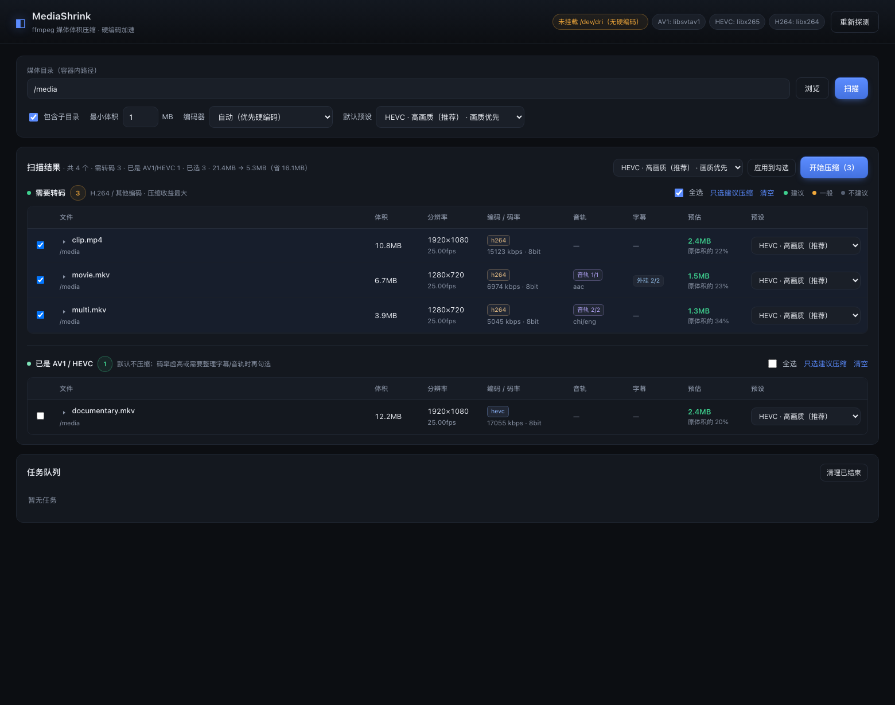
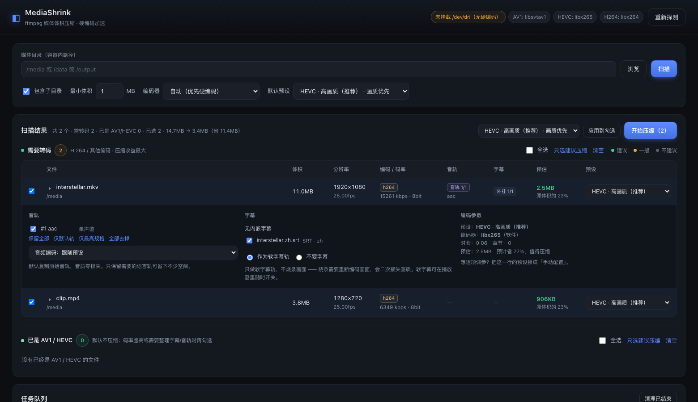
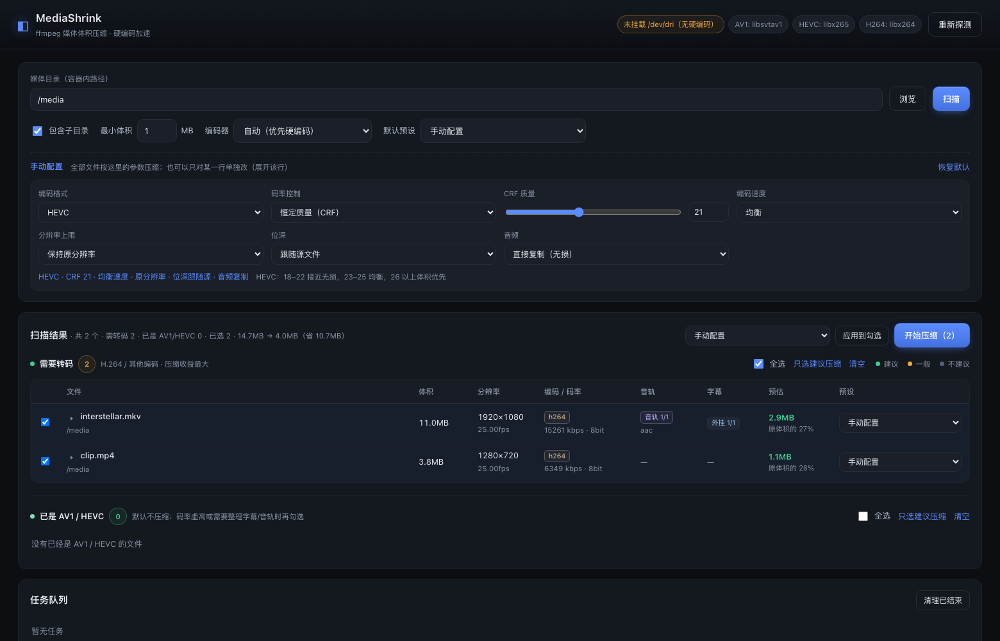
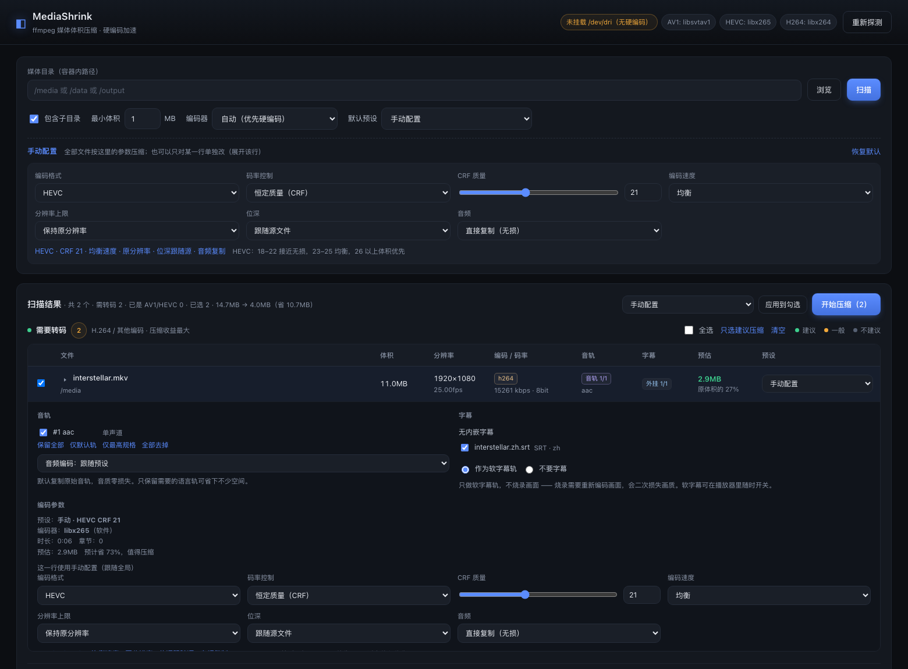
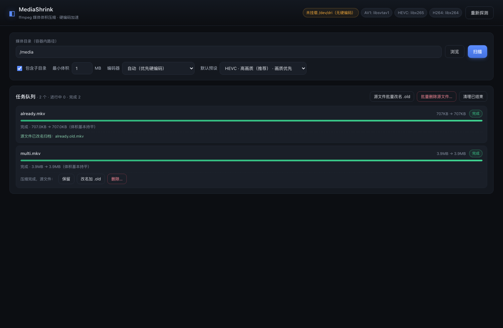
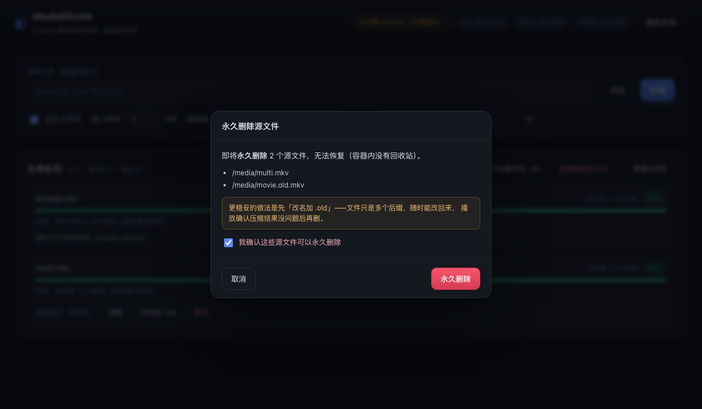
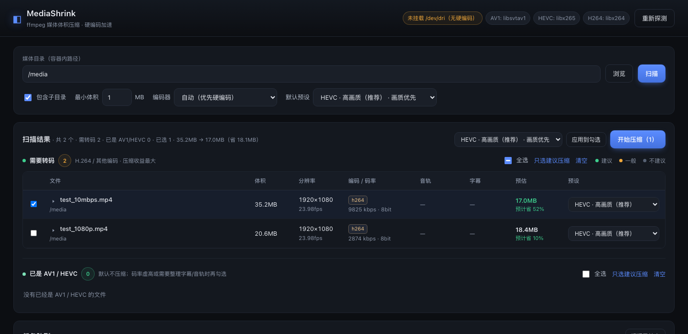
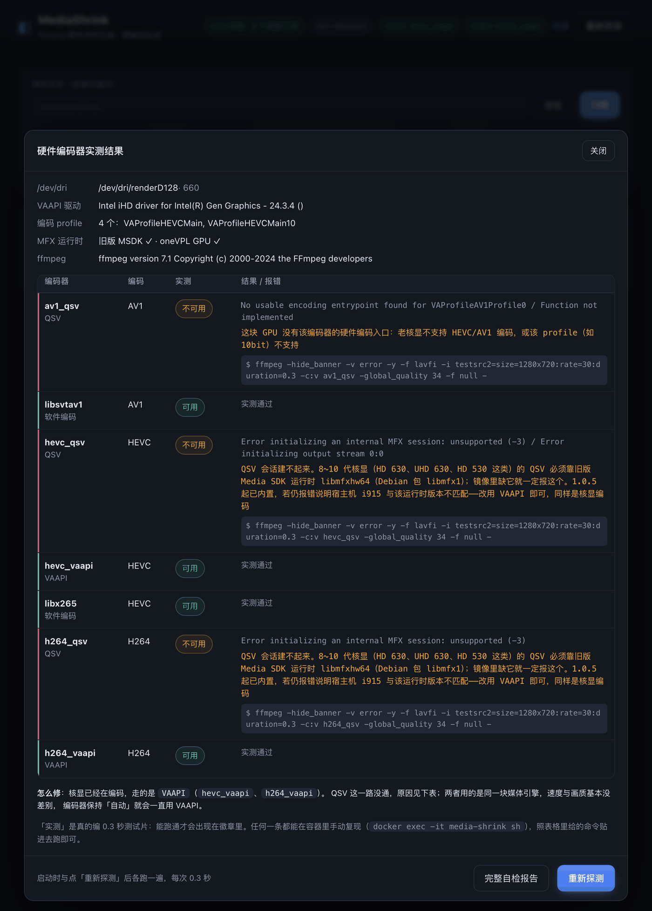
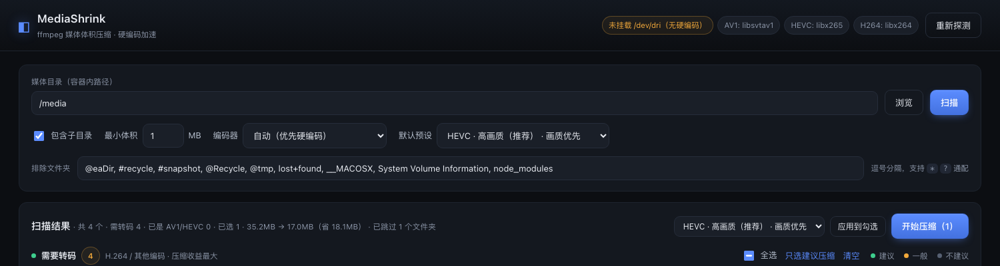
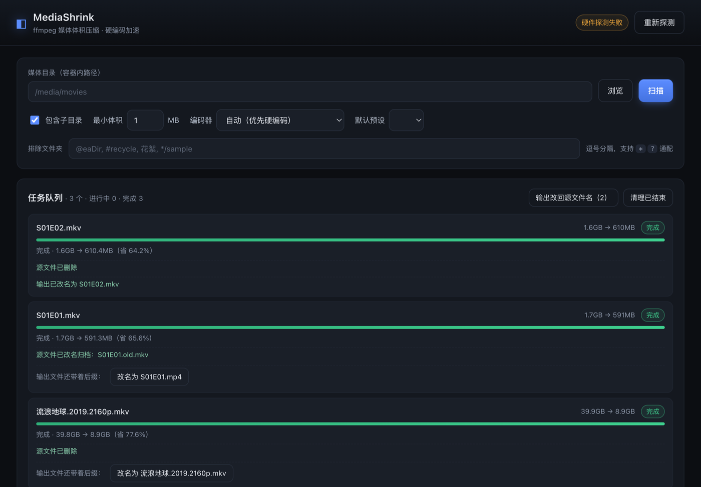

# MediaShrink

[](LICENSE)
[](#构建与推送镜像)
[](Dockerfile)

基于 ffmpeg 的媒体体积压缩服务。扫描媒体库 → 人工确认 → 批量转码，支持 Intel / NVIDIA / AMD 硬件编码。

网页操作，无需命令行。

> **English** — MediaShrink is a self-hosted web app that scans your media library, shows each file's codec, bitrate and estimated output size, and batch-transcodes only the files you tick. It ships AV1 / HEVC / H.264 presets (plus a fully manual mode), probes hardware encoders by actually encoding a test clip at startup (Intel QSV / VAAPI, NVIDIA NVENC, AMD VAAPI, or CPU), injects sidecar subtitles as soft tracks without burning them in, lets you pick audio tracks per file, and outputs MKV by default. Source files are never touched unless you explicitly rename (`.old`) or delete them afterwards. Documentation is in Chinese. MIT licensed.

---

## 功能对照

| 需求 | 实现 |
| --- | --- |
| 用 ffmpeg 压缩媒体体积 | 完整转码流水线，保留章节与元数据 |
| 扫描出来让人确认再压 | 扫描后列表展示原体积 / 分辨率 / 码率 / 预估体积 / 建议，逐项勾选，开始前二次确认 |
| **识别是否已是 AV1 / HEVC** | 扫描时按 `codec_name` 分组：非 AV1/HEVC 的进「需要转码」表；已是 AV1/HEVC 的单独进另一张表，默认不勾选 |
| 支持 Intel 核显硬编码 | QSV（`av1_qsv` / `hevc_qsv` / `h264_qsv`）+ VAAPI（`*_vaapi`）双通道 |
| 也支持 N 卡 / A 卡 | NVENC（`av1_nvenc` / `hevc_nvenc` / `h264_nvenc`）、AMD VAAPI（`*_vaapi`） |
| 同文件夹字幕自动加上 | 自动匹配 `影片名.*.srt/ass/vtt/sup`，默认全部勾选，可逐条取消 |
| **字幕不烧录** | 只做软字幕轨（mkv `copy` / mp4 `mov_text`），画面始终原样重编码，不做任何字幕叠加 |
| **默认输出 MKV** | 无论源文件是 mp4 还是 avi，统一封装成 `.mkv`：不限视频/音频编码，PGS/ASS 图形与特效字幕都能装，不会为了塞进 mp4 去重编码音轨 |
| **音轨可选** | 逐条勾选要保留的音轨（按语言 / 声道 / 码率 / 默认标记），可选「保留全部 / 仅默认轨 / 仅最高规格 / 全部去掉」 |
| **可排除文件夹** | 扫描时可跳过指定目录：默认已排除 `@eaDir` / `#recycle` / `lost+found` 等系统垃圾目录，界面上还能临时增删；支持 `*` `?` 通配，既能按目录名匹配，也能按相对路径匹配 |
| **压缩完可处理源文件** | 每个完成的任务都能选「保留 / 改名加 `.old` 后缀 / 删除」，删除需二次勾选确认；只有输出校验通过才允许操作 |
| **转码历史 + 避免重复压** | 每次成功都记一条（体积变化 / 用时 / 预设 / 编码器），可搜索回看；扫描时用「大小 + mtime」指纹比对，压过的标「已转过」且默认不勾选 |
| 较多预设可选 | 16 个预设：AV1 / HEVC / H.264 各有极致压缩→视觉无损多档，另有动画优化、HDR 保留、仅重封装 |
| **保留手动配置** | 预设之外还有一个「手动配置」：编码格式、CRF 或目标码率、编码速度、分辨率上限、位深、音频编码都能自己定，可全局生效也可只改某一行 |
| 优先 AV1 / HEVC | 全部预设基于 AV1 与 HEVC，H.264 仅作兼容兜底 |
| 优先原分辨率 | 默认完全不缩放；只有明确选「最高 1080p / 720p」预设才会缩小 |
| **画质优先** | 默认预设是 `HEVC · 高画质`（CRF 21）；字幕不烧录；音轨默认直接复制；默认保留 10bit / HDR |

**硬件编码采用「实测」而非「看 ffmpeg 支持列表」**：启动时对每个候选编码器真跑一次 0.3 秒编码，跑通才算可用。所以不会出现"界面显示支持、一压就报错"。

---

## 快速开始

镜像自行构建即可（linux/amd64，约 1.0 GB）。下文命令里的镜像名写作 `media-shrink`，纯本地用就是这么写；
想推到自己的镜像仓库就加前缀，写成 `<你的账号>/media-shrink:latest`。

### 方式一：直接运行（推荐）

先把镜像准备好，二选一：

```bash
./scripts/build.sh                    # 本地构建（版本号 + latest 双标签）
docker load -i media-shrink-1.2.0-amd64.tar   # 或者加载离线包
```

然后起容器：

```bash
docker run -d --name media-shrink --restart unless-stopped \
  -p 8420:8000 \
  -v /你的/影视目录:/media \
  -v /你的/appdata/media-shrink:/data \
  --device=/dev/dri:/dev/dri \
  media-shrink:latest
```

打开 <http://localhost:8420> ；也可以直接 `http://localhost:8420/?scan=/media/movies` 一步进到某个目录的扫描结果（适合收藏成书签）。

| 参数 | 说明 |
| --- | --- |
| `-p 8420:8000` | WebUI 端口，左边随便改，容器内固定 8000 |
| `-v ...:/media` | 媒体目录，容器内路径自己定，但必须出现在 `MEDIA_ROOTS` 里 |
| `-v ...:/data` | 任务记录，删掉只会丢历史，不影响压缩 |
| `--device=/dev/dri` | Intel 核显 / AMD 的硬编入口。**没有核显就整行删掉**，Docker 找不到设备会拒绝启动 |

默认输出写回源文件同目录，不用单独挂输出目录；想统一输出再加 `-v /你的/输出:/output` 并设 `OUTPUT_DIR=/output`。

### 方式二：从源码构建

```bash
git clone https://github.com/<你的账号>/media-shrink.git
cd media-shrink

docker compose up -d --build      # compose 里已经配好路径和参数
```

首次构建要下载 ffmpeg 静态构建（约 160 MB），成品镜像约 1.0 GB（静态 ffmpeg 二进制占 340 MB，换来零依赖、编码器齐全）。构建默认用中科大 apt 源（实测比官方源快一个数量级），海外网络改 `APT_MIRROR=deb.debian.org`。

### 界面





预设之外还有「手动配置」，全参数自己定（编码 / CRF 或码率 / 速度 / 分辨率 / 位深 / 音频）：



也可以只在某一行展开、单独改这一个文件，不影响其他行：



压缩完成后可以在任务卡片上直接处理源文件（保留 / 改名加 `.old` / 删除）：



删除需要勾选确认，弹窗会列出完整路径：



顶栏标题右边有个版本号小标签（如 `v1.0.9`），跑的是哪个镜像一眼可辨；浏览器标签页标题也会带上同一个版本号。

这个版本号是**后端渲染进 HTML 的**（`/` 返回前把 `{{APP_VERSION}}` 替换掉），不是等前端 JS 去填。所以哪怕浏览器缓存着旧的 `app.js`、甚至 JS 完全没跑起来，版本号也一定显示——它同时也是判断「容器到底换了没」的可靠依据。

---

## 扫描结果怎么读

扫描后是两个独立的表：

**① 需要转码** —— 编码不是 AV1 / HEVC 的文件（H.264、MPEG-2、VC-1、WMV…）。
默认勾选其中「建议压缩」的项。这一组是压缩收益的主要来源。

**② 已是 AV1 / HEVC** —— 已经是目标编码的文件。
默认全部不勾选。仍然列出来是因为三种情况值得重新处理：

- 码率虚高（比如老片子用 HEVC 但码率 20 Mbps），重压还能再省一半
- 容器里没有字幕，而同目录有匹配的外挂字幕 → 用「仅重封装」秒级加进去
- 音轨太多（国配 + 原声 + 导评），只留需要的能省不少空间

每行前面的 `▸` 展开可以单独改字幕、音轨、CRF、预设。



### 预估体积是怎么算的

预估列直接显示「预计省 x%」，因为它只是**经验估算**，不是精确值——真实结果只有转码完才知道。

模型由两部分合成：

1. **理论码率** —— 按 `bpp × 宽 × 高 × 帧率` 算，`bpp` 由编码器和质量档决定（例如 HEVC 高画质 0.056、AV1 均衡 0.032）。它回答的是"这个编码器在这个质量档下大概需要多少码率"。
2. **源码率锚定** —— CRF 编码的实际码率由**画面复杂度**决定，而同分辨率下源码率正是复杂度最直接的代理。所以再算一个 `源码率 × 编码器效率比`（H.264→HEVC 取 0.72，→AV1 取 0.58），与理论值取几何平均。

只做第 1 步会两头失真：

- 源是 3 Mbps 的 1080p H.264 → 理论值算出 3.2 Mbps，界面显示"体积还变大"，其实这种**已经被压过**的片源用 HEVC CRF 21 通常还能省 10~25%
- 源是 20 Mbps 的高码率母带 → 理论值同样算出 3.2 Mbps，严重低估

另外源码率是硬上限（留 2% 封装余量）：重编码不会凭空造出码率，所以估算值不会超过源文件太多。`±3%` 以内显示「体积基本持平」——这个区间属于估算误差，说成"增加"只会让人以为估算坏了。

> 选「目标码率」模式时不受以上影响，体积是直接算出来的（码率 × 时长），此时 `confidence` 为 high。

---

## 硬件加速配置

### Intel 核显（最常见）

```yaml
devices:
  - /dev/dri:/dev/dri
```

宿主机确认：

```bash
ls -l /dev/dri            # 应该有 renderD128
sudo apt install vainfo   # 然后
vainfo                    # 能看到 VAProfileXXX / VAEntrypointEncSlice 即可
```

容器起来后，界面顶部徽章就是**实测结果**（每个候选编码器都真跑过 0.3 秒测试片）：

| 徽章 | 含义 |
| --- | --- |
| 绿色 `Intel 核显 · 2 个硬编可用` | 核显在工作 |
| 黄色 `Intel 核显 · 硬件编码不可用` | 设备在，但硬编一个都没跑通 —— 此时任务会**用 CPU 跑** |
| 黄色 `未挂载 /dev/dri（无硬编码）` | 设备根本没进容器 |

点徽章右侧的「详情」，能看到每个候选编码器的实测结果、原始报错、人话解释，以及可以照着敲的复现命令：



弹窗底部的「完整自检报告」会把 `hw-doctor` 的输出直接贴在页面上（等同于在容器里执行
`docker exec -it media-shrink hw-doctor`），排查时截图这一块就够。

#### 核显不干活，按这个顺序查

1. **容器里到底有没有设备**

   ```bash
   docker exec -it media-shrink ls -l /dev/dri
   ```

   看不到 `renderD128` 就是没映射进去。compose 写 `devices: ["/dev/dri:/dev/dri"]`；
   Unraid 要在模板里加一个 **Device**（不是 Path！），名称 `/dev/dri`、值 `/dev/dri`，
   保存后**重建容器**（只点重启不生效）。

2. **驱动能不能打开设备**

   ```bash
   docker exec -it media-shrink vainfo --display drm --device /dev/dri/renderD128
   ```

   报 `Permission denied` 就给容器加 `--group-add video`（部分发行版是 `--group-add render`）。

3. **MFX 运行时是否齐全（8~10 代核显的关键）**

   QSV 由 `libvpl` 这个 dispatcher 统一入口，具体实现按 GPU 代际分两套：

   | GPU | 运行时库 | Debian 包 |
   | --- | --- | --- |
   | 5~10 代（Broadwell ~ Comet Lake，含 **HD/UHD 630**） | `libmfxhw64.so.1.35`（旧版 Media SDK） | `libmfx1` |
   | 11 代及以上（Tiger Lake / Arc） | `libmfx-gen.so.1.2`（oneVPL GPU） | `libmfx-gen1.2` |

   镜像 **1.0.5 起两者都装**，dispatcher 会按平台自动挑。如果只装了 `libvpl2`，
   8~10 代核显的 `hevc_qsv` / `h264_qsv` 会报
   `Error initializing an internal MFX session: unsupported (-3)` —— 1.0.4 及更早就是这个症状。

   ```bash
   docker exec -it media-shrink ls -l /usr/lib/x86_64-linux-gnu/libmfx*
   ```

4. **一条命令拿到全部结论**

   ```bash
   docker exec -it media-shrink hw-doctor
   ```

   依次打印设备节点、vainfo、MFX 运行时、ffmpeg 构建参数，并实测 `hevc_qsv` /
   `h264_qsv` / `hevc_vaapi` / `h264_vaapi`，每一步都直接给出通过/失败和失败原因。

5. **自己验一遍**（把 `hevc_qsv` 换成 `hevc_vaapi` 可以对比两条路径）：

   ```bash
   docker exec -it media-shrink ffmpeg -hide_banner -f lavfi \
     -i testsrc2=size=1280x720:rate=30:duration=1 \
     -c:v hevc_qsv -global_quality 26 -f null -
   ```

   同时用宿主机上的 `intel_gpu_top`（或「应用市场 → GPU Statistics」）看 `Video` 一栏是否有负载：
   编码时该值会明显上去，全程 0% 就说明确实在跑 CPU。

> 注意：如果你在「编码器」里**明确选了** Intel 核显 / NVIDIA，而实测没有可用硬编，任务会直接报错停下，
> 不会安静地用 CPU 跑几个小时（之前正是这样让人误以为核显在干活）。想先凑合跑就把编码器改成「自动」或「仅 CPU」。

编码能力对照：

- 5~10 代（含 UHD 630）：H.264 / HEVC 8bit 硬编；HEVC 10bit 从 Kaby Lake 起支持
  （QSV 走 `libmfx1`，VAAPI 走 `hevc_vaapi`，两条都能用，QSV 略快一点）
- 11 代（Tiger Lake）起：QSV 走 `libmfx-gen1.2`
- 11~13 代部分型号：支持 AV1 **解码**
- Arc / 14 代+（含核显 Xe2）：支持 AV1 **编码**（`av1_qsv`）

### NVIDIA

宿主机装 `nvidia-container-toolkit`，然后把 compose 里 `deploy:` 段取消注释：

```yaml
deploy:
  resources:
    reservations:
      devices:
        - driver: nvidia
          count: all
          capabilities: [gpu, video, compute, utility]
```

`capabilities` 里的 **video** 必须有，否则 NVENC 不可用。

### AMD

同样是 `/dev/dri`：

```yaml
devices:
  - /dev/dri:/dev/dri
```

Linux 下 ffmpeg 走 VAAPI（`hevc_vaapi`）。AV1 编码需要 RDNA3 及以上（RX 7000 系）。

> 注意：`*_amf` 编码器只在 Windows 版 ffmpeg 里存在，Linux 容器内不会出现，这是驱动层限制，不是本项目的问题。

### 强制用 CPU

界面上「编码器」选 **仅 CPU**，或对单个文件在展开行里指定。CPU 编码（`libsvtav1` / `libx265`）同码率画质更好，但慢 5~20 倍。

---

## 使用流程

1. **填写目录** —— 点「浏览」可视化选，或直接输入容器内路径（如 `/media/movies`）
2. **选默认预设** —— 默认是 `HEVC · 高画质`（画质优先）；扫描时按这个预设估算体积
3. **点扫描** —— 结果分成「需要转码」和「已是 AV1 / HEVC」两张表，各自有全选 / 只选建议 / 清空
4. **逐项确认（可选）** —— 点文件名前的 `▸` 展开：
   - 音轨：逐条勾选，或用「仅默认轨 / 仅最高规格 / 全部去掉」快速筛选；音频编码可选 复制 / AAC / Opus
   - 字幕：勾选要注入的外挂字幕，选「作为软字幕轨」或「不要字幕」（没有烧录选项）
   - 手动配置：把这一行的预设换成「手动配置」，就能单独给这个文件调编码 / CRF / 码率 / 速度 / 分辨率 / 位深
   - 单独换预设
5. **点「开始压缩」** —— 弹出汇总（体积变化、编码器、音轨数量、字幕数量、输出格式），确认后入队
6. 底部任务队列实时显示进度、速度、剩余时间，可随时取消

默认输出到源文件同目录，文件名加 `_compressed` 后缀，**绝不会覆盖源文件**；删不删源文件由你在压缩完成后逐个决定。

### 排除文件夹

扫描面板里有一行「排除文件夹」，逗号分隔，两种写法混用都行：

| 写法 | 匹配谁 |
| --- | --- |
| `@eaDir`、`花絮`、`Extras` | **任意层级**里名为这个的目录（不区分大小写） |
| `*sample*`、`Screen*` | 目录名通配（`*` 任意串、`?` 单个字符） |
| `电影/花絮`、`*/Extras` | 相对扫描根的**路径**，只跳过这个位置 |

几条约定：

- 以 `.` 开头的隐藏目录（`.git`、`.Trashes`）**始终跳过**，不用写进来
- 默认值来自环境变量 `EXCLUDE_DIRS`，已经覆盖 `@eaDir`、`#recycle`、`#snapshot`、`lost+found`、`__MACOSX`、`node_modules` 等常见垃圾目录
- 输入框里显示的就是「这次实际生效的清单」——删掉某个默认项它就真不排除了；改过的值记在浏览器 `localStorage`，下次打开还在
- 扫描结果的统计行会显示 `已跳过 N 个文件夹`，确认规则有没有生效

> 排除只影响扫描，不会去动磁盘上的任何文件。想看被跳过的目录恢复正常，把对应项从输入框里删掉再扫一次即可。



### 输出容器

默认一律封装成 **MKV**，源文件是 mp4 / avi / ts 都一样。原因是 MKV 没有编码和字幕类型的限制：

- 视频：AV1 / HEVC / H.264 都能装，`-c:v copy` 时不需要换容器就重编码
- 音频：AC3、DTS、TrueHD、FLAC、Opus 全部直接 `copy`；mp4 遇到 DTS 就只能转成 AAC，白损失一次
- 字幕：PGS / VobSub 图形字幕、ASS 特效字幕都保留原样；mp4 只能存文本字幕，图形字幕只能丢弃

想改回跟随源文件或输出 mp4，改环境变量即可（装不下时会自动退回 mkv，不会让任务失败）：

```yaml
OUTPUT_CONTAINER: "auto"   # 跟随源文件：mp4→mp4、webm→webm、其余→mkv
OUTPUT_CONTAINER: "mp4"    # 强制 mp4（遇 PGS/DVD 图形字幕的文件自动用 mkv）
```

### 压缩完怎么处理源文件

不会自动删任何东西。每个**压缩成功**的任务下方会出现三个选项：

| 选项 | 结果 | 什么时候用 |
| --- | --- | --- |
| 保留 | 什么都不做，只标记成已确认 | 想留着原片 |
| 改名加 `.old` | `movie.mkv` → `movie.old.mkv` | **推荐**。文件只是多个后缀，随时能改回来；播放一圈确认没问题再删 |
| 删除… | 永久删除，不进回收站 | 已经确认过压缩结果，要立刻腾空间 |

任务队列右上角还有一批：**源文件批量改名 .old** / **批量删除源文件…**，适合压完几十个文件后一次性收拾。

删除的按钮是「删除…」（带省略号），点了会弹出确认框列出完整路径，还要勾一个「我确认这些源文件可以永久删除」才会真正执行。

#### 把输出的 `_compressed` 后缀去掉

转码结果默认带后缀（`movie.mkv` → `movie_compressed.mkv`），重复压同一个文件还会变成 `_compressed_1`。想让它直接叫回原名，**不需要手动去文件管理器改名**：

处置完源文件（删除或改名 `.old`）后，任务行下方会多出一个按钮 **「改名为 movie.mkv」**，点一下就把输出改成源文件名（扩展名跟随实际输出，比如容器换成 mp4 就是 `movie.mp4`）。队列右上角也有 **「输出改回源文件名（N）」** 可以批量做。

几条安全规则：

- **源文件还在原位时不会给这个按钮** —— 名字被占着，改名会盖掉源文件。必须先删除或改名归档
- 目标文件名已存在时拒绝执行，不会覆盖任何东西
- 同一个任务只能改一次，改名后显示「输出已改名为 …」

重名的 `_compressed_1`、`_compressed_2` 同样能改回原名（`剧集 S01E01.mkv`），所以批量压一季番剧后一次点完，目录里就是干净的原始命名。



服务端还有一层兜底，下面任何一条不满足都拒绝操作源文件（宁可不动手）：

- 任务状态必须是 `done`
- 输出文件必须存在、非空
- 输出体积不能小于 1MB，也不能小于源文件的 0.5%（基本可以断定是截断的失败产物）——这种情况会提示先播放确认
- 源文件与输出文件不能是同一个文件
- 同一个任务不能处理两次

「输出改回源文件名」另外还有两道：必须已经处置过源文件（`delete` 或 `rename`），且目标文件名不存在（存在就中止，绝不覆盖）。

想彻底禁用删除，设 `ALLOW_SOURCE_DELETE: "0"`，界面上的删除按钮直接变灰，API 也会返回 403。

> 改名只动视频文件本身，不会碰同目录的外挂字幕。`movie.old.mkv` 下次扫描会被识别成 `.old` 归档并标为「跳过」，不会被当成新片子再压一遍。

---

## 转码历史（避免重复转码）

每压成功一个文件，服务端就往历史里记一条：源路径、输出路径、压缩前后体积、用时、预设、编码器、完成时间。
历史存在数据卷的 `history.json` 里（默认 `/data/history.json`），**容器重建、升级镜像都不会丢**。

页面最下方是「转码历史」面板：按时间倒序显示，能搜索文件名，能翻页，顶上显示累计省了多少空间。
队列里一有任务完成，面板会自动刷新。清空历史需要二次确认。

### 怎么避免重复转码

扫描时用 **文件大小 + mtime** 当指纹去比对历史：

- 源文件压过、且之后没被改动 → 标成 `已转过`，**默认不勾选**，理由写明「已于 X 转码过，12.3GB → 4.1GB」
- 压缩完把输出改名回了源文件名 → 靠输出路径 + 输出指纹反查，照样认得出「这是那次转码的产物」，不会当成新片子再压一遍
- 文件被重新下载/替换过（大小或 mtime 变了）→ 指纹对不上，正常参与压缩，不会误判

想故意重压（换预设、换 CRF 再试一次），勾上扫描区的 **「忽略转码历史」** 再扫，所有文件都按原始规则评估。
已经勾着「已转过」的文件去压缩时，确认框里会列出来提醒一句，但不会硬拦。

> 清空历史会失去这个能力——下次扫描就认不出哪些压过了。清空前会二次确认。

---

## 关于画质

三个默认行为都是为了不损画质：

| 做法 | 原因 |
| --- | --- |
| 字幕只做软轨 | 烧录（hardsub）要把字幕合成到画面再重新编码，等于在压缩损失之上再叠一次损失。软字幕轨由播放器实时叠加，画面保持纯净，还能开关 |
| 音轨默认 `copy` | 音轨重新编码会损失细节，而音频体积通常只占 5~10%，省不了多少 |
| 默认保留 10bit / HDR | 源是 10bit 就输出 10bit，HDR10 / HLG 元数据与色彩标记原样传递 |

需要更极致的画质可以在展开行里把 CRF 调低（HEVC 18~20 已经很接近视觉无损）。

---

## 预设一览

| 预设 | 适用 |
| --- | --- |
| **HEVC · 高画质（推荐）** | **默认。画质优先，兼容性最好，硬编码支持最广** |
| AV1 · 高画质 / 视觉无损 | 收藏级片源，同画质比 HEVC 再小 20~30% |
| AV1 · 均衡 | 通用归档 |
| AV1 · 极致压缩 | 空间极度紧张，画质有可见损失 |
| AV1 · 动画/番剧 | 关胶片颗粒合成，再省 15~25% |
| AV1 · 4K/HDR 保留 | 10bit + HDR 元数据原样保留 |
| HEVC · 均衡 | 兼容性与压缩率平衡 |
| HEVC · 极致压缩 | 激进档 |
| HEVC 10bit · HDR 原样保留 | 强制 10bit，HDR10/HLG 完整保留 |
| HEVC · 动画/番剧 | 平涂色块优化 |
| H.264 · 兼容优先 / 小体积 | 老设备、网页播放 |
| HEVC · 最高 1080p / AV1 · 最高 720p | 主动降分辨率（唯一会缩放的预设） |
| 仅重封装 | 只换容器 + 加字幕 + 裁音轨，画质零损失，秒级完成 |
| **手动配置** | 上面都不合适时的出口：编码、CRF/码率、速度、分辨率、位深、音频全自己定 |

CRF 参考：HEVC 18~24，AV1 23~30（画质优先取小值），数值越小画质越好、体积越大。

---

## 手动配置

预设覆盖的是常见组合，剩下的特殊情况走「手动配置」——它在预设下拉框里，位置和普通预设一样，选中后下方会展开参数区。

| 参数 | 可选值 | 说明 |
| --- | --- | --- |
| 编码格式 | AV1 / HEVC / H.264 | 选完自动按你的硬件匹配编码器（QSV / NVENC / VAAPI / CPU） |
| 码率控制 | 恒定质量（CRF） / 目标码率 | CRF 画质稳定、体积浮动；目标码率体积可控 |
| CRF 质量 | 滑杆 + 数字输入，0~63 | 切换编码格式时上限自动跟着变 |
| 视频码率 | 200~200000 kbps | 仅「目标码率」模式显示，实际编码会按 1.5× 峰值 / 2× 缓冲做 VBR |
| 编码速度 | 极速 / 快 / 均衡 / 慢 / 最慢 | 映射到各编码器自己的参数：x265 `ultrafast…veryslow`、SVT-AV1 `12…2`、NVENC `p2…p7`、QSV `veryfast…veryslow` |
| 分辨率上限 | 保持原分辨率 / 2160p / 1440p / 1080p / 720p | 只在源分辨率更高时缩小，不会放大 |
| 位深 | 跟随源文件 / 强制 8bit / 强制 10bit | 强制 10bit 会走 `yuv420p10le` / `p010le` |
| 音频 | 直接复制 / 转 AAC / 转 Opus | 和展开行里的「音频编码」是同一套，那里选过就以那里为准 |

作用范围有两种：

- **全局**：把顶部的「默认预设」选成「手动配置」，参数区出现在扫描面板里，所有文件都按它压
- **单文件**：把某一行的预设换成「手动配置」，展开该行单独调；改过之后这行就脱离全局，点「恢复跟随全局」能退回去

配置会存在浏览器里（`localStorage`），下次打开还是你上次调的值；「恢复默认」按钮回到出厂参数（HEVC / CRF 21 / 均衡 / 原分辨率 / 音频复制）。

体积预估对两种模式都准：CRF 模式走经验公式（±20% 量级），目标码率模式直接按 `码率 × 时长` 算，基本就是实际大小。

**注意**：手动配置里选了什么不改变扫描分组——分组看的是源文件编码，不是目标编码。

---

## 环境变量

| 变量 | 默认 | 说明 |
| --- | --- | --- |
| `MEDIA_ROOTS` | `/media,/data,/output` | 允许浏览/扫描的根目录（安全边界） |
| `OUTPUT_DIR` | 空 | 留空=输出到源文件旁；填 `/output`=统一输出目录 |
| `OUTPUT_SUFFIX` | `_compressed` | 输出文件后缀 |
| `OUTPUT_CONTAINER` | `mkv` | 输出容器：`mkv` / `mp4` / `webm` / `auto`（跟随源文件） |
| `SOURCE_ACTION` | `keep` | 源文件默认处理：`keep` / `rename` / `delete`（界面仍逐个确认） |
| `SOURCE_OLD_SUFFIX` | `.old` | 归档后缀，`movie.mkv` → `movie.old.mkv` |
| `ALLOW_SOURCE_DELETE` | `1` | 设 `0` 禁用删除源文件，只留「保留 / 改名」 |
| `ACCESS_TOKEN` | 空 | 访问令牌。设了之后页面和接口都要令牌（详见「访问控制」） |
| `TOKEN_COOKIE_DAYS` | `30` | 令牌 Cookie 有效期（天） |
| `MAX_JOBS_PER_REQUEST` | `200` | 单次提交任务数上限 |
| `PROBE_WORKERS` | CPU 核数（最多 6） | ffprobe 并发数，全局共享 |
| `PROBE_CACHE_MAX` | `4000` | ffprobe 结果缓存条数上限（LRU） |
| `HW_REPORT_COOLDOWN` | `15` | `/api/hw/report` 冷却秒数（自检要真跑编码） |
| `CONCURRENT_JOBS` | `1` | 并行任务数。硬件编码建议 1~2 |
| `VAAPI_DEVICE` | `/dev/dri/renderD128` | VAAPI 渲染节点 |
| `MIN_SIZE_MB` | `1` | 扫描时忽略小于此体积的文件 |
| `EXCLUDE_DIRS` | `@eaDir,#recycle,#snapshot,@Recycle,@tmp,lost+found,__MACOSX,System Volume Information,node_modules` | 扫描时跳过的目录，逗号分隔，不区分大小写，支持 `*` `?` 通配；以 `.` 开头的隐藏目录始终跳过 |
| `DATA_DIR` | `/data` | 数据目录，转码历史存在这里（容器重建不丢） |
| `HISTORY_FILE` | `<DATA_DIR>/history.json` | 转码历史文件路径，指到别处也行；留空 + `DATA_DIR` 为空 = 只存内存 |
| `HISTORY_MAX` | `5000` | 历史最多保留多少条（超出按最旧淘汰） |
| `APT_MIRROR` | `deb.debian.org` | 构建期 apt 源 |
| `FFMPEG_TAG` | `latest` | 构建期 ffmpeg 版本（BtbN 构建的 tag） |

---

## 访问控制

**默认没有登录**，适合「只在自己机器 / 完全可信的内网」用。因为它能读整个媒体库、还能删源文件，
一旦端口映射到公网或半开放的内网（宿舍、公司、带访客 Wi-Fi 的家用网络），请务必设一个令牌：

```bash
# -p 127.0.0.1:8420:8000 表示只监听本机；要从别的机器访问就用反向代理（Nginx/Caddy）并加 HTTPS
docker run -d --name media-shrink --restart unless-stopped \
  -p 127.0.0.1:8420:8000 \
  -e ACCESS_TOKEN=换成一个长随机串 \
  -v /你的/影视目录:/media -v /你的/appdata/media-shrink:/data \
  --device=/dev/dri:/dev/dri \
  media-shrink:latest
```

生成一个够强的令牌：`openssl rand -hex 24`（或 `python3 -c "import secrets;print(secrets.token_urlsafe(32))"`）。

然后：

- **浏览器**：打开 `http://localhost:8420/?token=你的令牌`，页面会写一个 `HttpOnly + SameSite=Strict`
  的 Cookie（默认 30 天），之后直接开 `http://localhost:8420/` 即可，地址栏里不会残留令牌。
- **脚本 / curl**：带 `-H "X-Auth-Token: 你的令牌"`（也支持 `Authorization: Bearer 你的令牌`）。
- **换令牌**：旧 Cookie 立刻失效，重新用新令牌打开一次即可。

另外，写操作（POST）有三条硬性限制，用来挡住「你随手打开一个恶意网页，它偷偷让家里的服务删文件」：

1. 浏览器带 `Sec-Fetch-Site: cross-site` 的请求直接 403；
2. `Origin` 与 `Host` 不一致的请求直接 403；
3. 带 body 的请求必须是 `application/json`（表单和 `text/plain` 属「简单请求」，不需要预检就能发，是 CSRF 的常用载体）。

命令行工具不带这些请求头，不受影响。

**再降一档风险**：不需要删源文件就设 `ALLOW_SOURCE_DELETE=0`；只想本机用就把端口映射写成
`-p 127.0.0.1:8420:8000`，外面用 Nginx/Caddy 反代并加 HTTPS。

**关于 root**：镜像默认以 root 跑（`/dev/dri` 和 bind mount 的权限最省事）。想更严格可以自己降权：

```bash
docker run ... --user $(id -u):$(id -g) --group-add $(getent group render | cut -d: -f3) ...
```

代价是宿主机上的媒体目录、`/data` 必须对该 UID 可读写，否则会报「无法创建输出文件」。

---

## 常见问题

**界面显示「未挂载 /dev/dri」**
compose 里的 `devices` 没生效，或宿主机没有 `/dev/dri`（虚拟机 / 群晖需开启核显直通）。

**编码器测试全部失败，但 `/dev/dri` 存在**
容器内缺 VAAPI 驱动。进容器跑 `vainfo` 看报错；群晖/Unraid 常需要额外映射 `/dev/dri` 的权限。

**AV1 硬编不可用**
只有 Arc 独显、部分 14 代+ 酷睿、RDNA3 的 A 卡支持 AV1 硬件**编码**。其余平台会回落到 `libsvtav1`（CPU），速度慢属正常。

**已经是 HEVC 的片源，勾了压缩反而变大了**
原片码率已经很低（第二张表里会标「不建议」）。这种情况选「仅重封装」或直接跳过。

**保留的音轨在播放器里显示「未知语言」**
转码时会显式把源语言标签（`chi` / `eng` / `jpn`…）写回输出流。如果源文件本身就没有语言标签，界面上也只能显示编码格式，需要先用 mkvtoolnix 打标签。

**能不能自动删源文件**
不会自动删。压缩完成后每个任务会出现「保留 / 改名加 .old / 删除…」三个选项，必须你手动点；删除还要勾确认框，并且输出文件得先通过完整性检查。觉得太危险就设 `ALLOW_SOURCE_DELETE=0` 直接关掉删除，只留改名归档。

**设了 ACCESS_TOKEN，用 `?token=` 打开却一直停在令牌页**
Cookie 没写进去：无痕窗口关掉即失效、浏览器禁用了 Cookie、或你从另一个域名/IP 访问（Cookie 按主机名隔离，换 IP 要重新带一次 `?token=`）。反向代理如果改写了 Host，也会导致 `Origin` 校验失败，此时在代理里原样传递 `Host` 头即可。

**换了新镜像，界面却还是老样子（新功能不出现）**
先看顶栏标题右边的版本号：和 `docker inspect <容器> --format '{{.Config.Image}}'` 里的标签对不上，说明容器还在跑旧镜像（重启容器不会换镜像，要 `docker rm -f` 后重起或 `compose up -d --force-recreate`）。版本号对得上但界面没变，就是浏览器缓存了 `/static/app.js`，`Cmd/Ctrl+Shift+R` 强刷一次。

> 1.1.0 起任务列表支持 `?rev=` 增量（没变化只回几十字节）且不再下发 ffmpeg 命令行，前端轮询改成空闲 5 秒 / 忙碌 1.2 秒；
> 1.0.9 起版本号由后端直接写进 HTML，连 `app.js` 都不用加载就能看到；1.0.8 起前端资源带 `Cache-Control: no-cache`（每次回源校验，没变就 304）。早于 1.0.8 的版本没有这个头，需要手动强刷。

---

## 目录结构

```
media-shrink/
├── Dockerfile            # 多阶段：BtbN ffmpeg 静态构建 + Debian slim 运行时
├── docker-compose.yml
├── requirements.txt
├── LICENSE
├── scripts/build.sh      # 构建镜像（强制双标签：版本号 + latest，并校验一致）
├── tools/                # make_favicon.py 生成站点图标、github-actions-ci.yml 可选的 CI 配置
├── docs/                 # 界面截图
├── test/e2e.sh           # 端到端自检
└── app/
    ├── main.py           # FastAPI 路由
    ├── auth.py           # 访问令牌 + 跨站请求拦截
    ├── config.py         # 环境变量配置
    ├── probe.py          # ffprobe 解析（含音轨/字幕流元数据）
    ├── presets.py        # 预设矩阵 + 编码参数映射 + 体积估算
    ├── hwdetect.py       # 硬件实测探测
    ├── scanner.py        # 目录扫描 / 编码分组 / 字幕匹配 / 建议
    ├── history.py        # 转码历史（持久化 + 指纹比对，避免重复转码）
    ├── transcoder.py     # 命令构建（音轨精确映射）+ 队列 + 进度
    └── static/           # 前端（原生 JS，无构建）
```

---

## 构建与推送镜像

用 `scripts/build.sh`，别手敲 `docker build`。它从 `app/config.py` 读版本号，**强制同时打「版本号 + `latest`」两个标签，并校验两者指向同一镜像**，校验不过直接退出——避免哪天忘了 `latest`，别人 `pull latest` 拿到的还是上一版。

```bash
./scripts/build.sh              # 只构建（版本号 + latest 双标签）
./scripts/build.sh --tar        # 构建 + 导出 dist/media-shrink-<版本>-amd64.tar（包内同样双标签）+ sha256
./scripts/build.sh --push       # 构建 + 推送两个标签（先 docker login）
NS=你的账号 ./scripts/build.sh  # 加仓库前缀：<你的账号>/media-shrink:<版本> + :latest
```

不设 `NS` 时镜像名就是 `media-shrink:<版本>` / `media-shrink:latest`，纯本地用足够了；
要推到镜像仓库（Docker Hub、私有 Registry 都行）就得设 `NS`，否则会推到 `docker.io/library` 被拒。

手动等价命令长这样（不推荐，容易漏标签）：

```bash
NS=你的账号
docker build -t $NS/media-shrink:$VERSION -t $NS/media-shrink:latest .
docker push $NS/media-shrink:$VERSION
docker push $NS/media-shrink:latest
```

`latest` 和版本号指向同一个镜像 ID，别人 `docker pull $NS/media-shrink:latest` 就能用；想回滚旧版也有具名标签可拉。推送后到仓库里确认 `latest` 的 digest 与版本号一致，否则就是没推上去。

本机是 x86_64，`docker build` 出来的就是 `linux/amd64`，普通 NAS / 服务器都能直接用。要同时出 arm64（树莓派、ARM 版 NAS）就换成 buildx：

```bash
NS=你的账号
docker buildx build --platform linux/amd64,linux/arm64 \
  -t $NS/media-shrink:latest -t $NS/media-shrink:$VERSION --push .
```

> 1 GB 的镜像推一次几分钟，取决于上行带宽。改完代码只重建最后几层，`docker push` 也只会推变化的分层。

## API

设了 `ACCESS_TOKEN` 后，除 `/api/health` 外的接口都要带 `X-Auth-Token`（或 `Authorization: Bearer`）。
POST 一律要 `Content-Type: application/json`。

| 方法 | 路径 | 说明 |
| --- | --- | --- |
| GET | `/api/hw` | 硬件与编码器探测结果 |
| POST | `/api/scan` | 扫描目录，返回带 `codec_family` 分组信息的 items；`exclude` 传本次要跳过的目录 glob 数组（叠加在 `EXCLUDE_DIRS` 之上）；`ignore_history: true` 时不套用转码历史 |
| POST | `/api/estimate` | 重算体积。可传 `items: [{path, preset_id, manual, tracks}]` 逐条指定；也兼容旧的 `paths + preset_id + tracks` |
| POST | `/api/jobs` | 创建转码任务（`audio_tracks` 为流 index 数组，`null` 表示全部） |
| GET | `/api/jobs` | 任务列表与进度。带 `?rev=<上次返回的 rev>` 时，无变化只回 `{rev, changed:false}` |
| GET | `/api/history` | 转码历史：`?q=<关键词>&limit=100&offset=0`，返回 `{total, items, stats}` |
| POST | `/api/history/clear` | 清空转码历史（清掉后失去「已转过」的判断依据） |
| GET | `/api/health` | 健康检查（无需令牌） |
| POST | `/api/jobs/{id}/cancel` | 取消任务 |
| POST | `/api/jobs/source` | 处理源文件：`{job_ids, action: keep/rename/delete, confirm}`；删除必须 `confirm=true` |
| POST | `/api/jobs/rename-output` | 把输出改回源文件名：`{job_ids}`；仅当源文件已删除或已改名归档时可执行 |

## 自检

```bash
bash test/e2e.sh
```

脚本会自动走完一整条链路：造测试素材（H.264 单音轨 / H.264 无音轨 / H.264 双音轨 / 已是 HEVC，含中英文外挂字幕）→ 起容器 → 扫描并断言编码分组 → 重封装注入字幕（断言视频流未被重编码）→ 只保留一条音轨（断言输出音轨数）→ HEVC 压缩（断言编码与分辨率）→ 手动配置（断言编码器选择、码率预估、输出 10bit / 720p / 900kbps）→ 源文件保留 / 改名 / 删除的安全校验。需要 Docker 与 python3（解析 JSON），改动代码后跑一遍即可回归。

---

## 参与贡献

提 Issue 或 PR 都欢迎。改动前建议先跑一遍 `bash test/e2e.sh`；涉及前端改动的，说明一下改的是哪个交互。

本项目只做「体积压缩 + 元数据整理」，不追求成为完整的转码工作台，功能建议请围绕这条主线。

---

## 许可证

[MIT](LICENSE) © 2026 The MediaShrink Authors

镜像里打包的 [ffmpeg](https://github.com/BtbN/FFmpeg-Builds) 是 GPL 构建（含 libx265 / libsvtav1 / x264 等），
分发镜像时需同时遵守其 GPL 条款；本项目自身的代码仍是 MIT。

